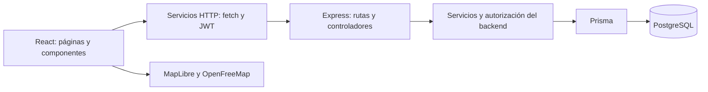
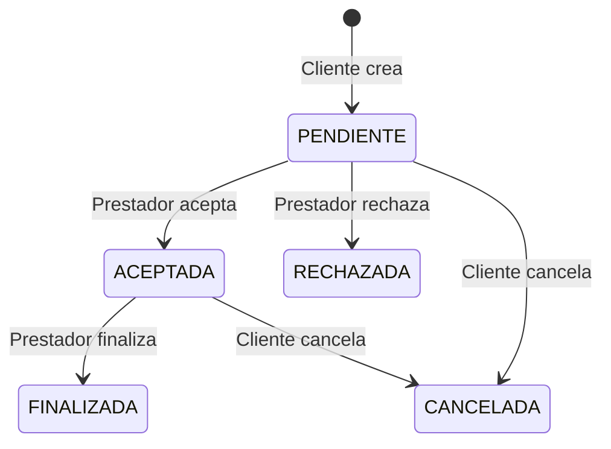

# ServiMap

Frontend de una plataforma de servicios del hogar, desarrollado con **React y Vite** para la materia **Construcción de Software**. Conecta clientes con prestadores mediante un directorio, un mapa y un circuito de solicitudes, calificaciones y administración.

La interfaz web vive en este repositorio. La API Node.js/Express, Prisma y PostgreSQL se mantienen en un [repositorio independiente](https://github.com/valenbalda/servimap-backend).

**Estado verificado al 30/10/2026:** 431 pruebas aprobadas, lint y build correctos, 84 controles de navegador con API simulada aprobados. Hay pendientes de dependencias, aceptación y validación autenticada real; estos resultados no certifican una publicación en producción. Ver la [auditoría integral](docs/auditoria-integral.md).

Accesos: [Instalación](#instalacion) · [Rutas](#rutas) · [Contratos HTTP](#contratos) · [Pruebas](#pruebas) · [Demos](#demos) · [Estado y limitaciones](#estado) · [Presentación universitaria](#presentacion).

## 1. Descripción general

Encontrar un profesional suele requerir buscar contactos dispersos, consultar su zona de trabajo y averiguar si está disponible. ServiMap reúne esa información para explorar oficios, comparar rangos de precio y reputación, consultar fichas y solicitar un servicio.

Está pensado para personas que necesitan un trabajo en su hogar, profesionales que ofrecen esos servicios y administradores que mantienen el catálogo y moderan comentarios. Los oficios disponibles provienen del backend: la interfaz productiva no impone un catálogo ficticio.

## 2. Objetivos

**Objetivo general:** facilitar el encuentro y la gestión de servicios entre clientes y prestadores mediante una aplicación web integrada con una API REST.

Objetivos específicos:

- Ofrecer búsqueda y filtros de oficio, zona, precio, calificación y disponibilidad.
- Mostrar ubicaciones públicas aproximadas en un mapa, manteniendo utilizable el listado sin coordenadas.
- Crear, consultar y gestionar solicitudes según el rol, la titularidad y el estado.
- Incorporar calificaciones de trabajos finalizados y moderación con motivo.
- Permitir al prestador administrar su información profesional y sus oficios.
- Mantener una interfaz responsive, estados de carga/error y pruebas reproducibles sin escrituras en producción.

La búsqueda por cercanía o radio sigue siendo un alcance parcial: la API la admite, pero la interfaz no ofrece ese filtro.

## 3. Características principales

| Módulo | Funciones implementadas |
| --- | --- |
| Entrada pública | Landing, modal «Cómo funciona», registro por rol y acceso a login. |
| Cuenta | Registro con DNI, login JWT, sesión de pestaña, expiración y logout local. |
| Directorio | Búsqueda y filtros, ficha remota, contactos, precios, reputación y comentarios. |
| Mapa | MapLibre, OpenFreeMap Liberty, marcadores aproximados, ubicación voluntaria e indicaciones externas. |
| Cliente | Panel de accesos, creación desde la ficha, historial, detalle, cancelación y calificación. |
| Prestador | Resumen de actividad, solicitudes, aceptación/rechazo/finalización, perfil, disponibilidad, precios, ubicación y oficios. |
| Administración | Alta/edición y activación de oficios; comentarios publicados/ocultos y moderación con motivo. |
| Calidad | Tests, recorridos de navegador simulados, demos locales y controles reales de lectura. |

## 4. Roles y permisos

| Acción | Visitante | CLIENTE | PRESTADOR | ADMINISTRADOR |
| --- | --- | --- | --- | --- |
| Ver directorio, fichas y mapa | Sí | Sí | Sí | Sí |
| Registrarse públicamente | Cliente o prestador | No es edición de cuenta | No es edición de cuenta | El rol administrador no se ofrece |
| Crear/cancelar solicitudes propias | No | Según estado | No | No |
| Calificar una solicitud propia finalizada | No | Una vez por solicitud | No | No |
| Aceptar/rechazar/finalizar trabajos recibidos | No | No | Según estado | No |
| Editar perfil profesional y oficios propios | No | No | Sí | No |
| Administrar catálogo y moderar comentarios | No | No | No | Sí |

El administrador no hereda las operaciones de cliente o prestador. La UI restringe rutas y controles; **la autorización efectiva corresponde al backend**, que valida JWT, rol y propiedad del recurso.

## 5. Recorridos por rol

### Cliente

1. Elegir «Empezar como cliente» en la landing, o explorar servicios sin sesión.
2. Registrarse y luego iniciar sesión; el registro no inicia sesión automáticamente.
3. El login actual vuelve a `/`. Entrar en «Explorar servicios» para acceder al directorio y a la navegación de la cuenta.
4. Buscar un prestador, abrir su ficha y pulsar «Solicitar servicio» si está disponible.
5. Seleccionar un oficio ofrecido, describir el trabajo y, opcionalmente, indicar dirección/contacto preferido.
6. Consultar «Mis solicitudes», abrir el detalle y cancelar una pendiente o aceptada con confirmación.
7. Cuando el prestador finaliza el trabajo, calificarlo una sola vez con puntaje de 1 a 5 y comentario opcional.

### Prestador

1. Elegir «Empezar como prestador», registrarse e iniciar sesión.
2. Acceder a «Mi panel de prestador» desde la navegación del directorio.
3. Completar perfil profesional, zona, contactos, precios, disponibilidad y coordenadas privadas si corresponde.
4. En «Mis oficios», agregar/quitar asociaciones del catálogo activo y guardar.
5. Revisar el panel, las solicitudes recibidas y sus detalles.
6. Aceptar o rechazar pendientes; finalizar aceptadas cuando termine el trabajo.
7. Consultar las calificaciones recibidas en «Mi perfil».

### Administrador

1. Usar una cuenta administradora provista por el responsable del backend; no se crea desde el registro público.
2. Iniciar sesión y abrir «Panel de administración» en la navegación o `/admin`.
3. Crear/editar nombres de oficios y activar/desactivar registros sin borrarlos.
4. En «Moderación de comentarios», elegir «Ocultar», ingresar un motivo y confirmar.
5. Revisar el comentario en la sección de ocultos. La UI no ofrece restaurarlo.

## 6. Tecnologías y versiones verificadas

Versiones resueltas comprobadas en `package-lock.json` y la instalación con `npm ls --depth=0`. Los rangos de `package.json` pueden diferir: `^19.2.8` resuelve actualmente React `19.3.0`.

| Tecnología | Versión verificada | Propósito |
| --- | --- | --- |
| Node.js | Requisito `24.x`; validación con `24.22.2` | Runtime de herramientas y QA. |
| npm | `10.9.3` en la terminal inspeccionada | Dependencias; no se fija una versión de npm en el proyecto. |
| React / React DOM | `19.3.0` | Componentes, estado y renderizado. |
| React Router DOM | `7.18.4` | Navegación SPA y rutas protegidas. |
| Vite | `8.3.2` | Desarrollo y compilación. |
| Plugin React para Vite | `6.1.2` | Integración de React. |
| MapLibre GL JS | `6.16.0` | Mapa vectorial y marcadores. |
| Vitest | `5.0.3` | Pruebas automatizadas. |
| Testing Library React / jest-dom | `16.3.3` / `7.0.1` | Interacciones y aserciones de componentes. |
| jsdom | `30.1.2` | DOM de pruebas; no reproduce WebGL ni layout real. |
| ESLint | `10.12.0` | Análisis estático JavaScript/React. |
| Inter y Georgia | Fuente local / serif del sistema | Cuerpo y títulos de la identidad visual. |

El frontend usa JavaScript/JSX, CSS y módulos ES. No incorpora Prisma, Express ni un cliente de base de datos en el navegador. El backend declara Express `^5.2.1` y Prisma `^6.19.3`; son versiones declaradas en su repositorio, no una comprobación de paquetes desplegados.

## 7. Arquitectura y comunicación



- **Presentación:** páginas por rol, componentes y estilos.
- **Estado:** hooks para formularios, selección y carga; Context para sesión.
- **Servicios HTTP:** centralizan origen, rutas, JSON, Bearer y errores; adaptan respuestas a la UI.
- **API:** valida entradas, identidad, permisos y transiciones; persiste con Prisma en PostgreSQL.
- **Cartografía:** se descarga de OpenFreeMap; los datos de profesionales vienen de ServiMap.

Una modificación solo se confirma después de una respuesta exitosa. Las transiciones vuelven a consultar el listado. El navegador no accede directamente a PostgreSQL ni necesita sus credenciales.

## 8. Estructura real del repositorio

```text
servimap-frontend/
├── .github/workflows/frontend-tests.yml  # CI de PR hacia develop
├── public/
│   ├── fonts/                           # Inter y licencia
│   ├── illustrations/                   # SVG de la landing
│   ├── favicon.svg
│   └── icons.svg
├── src/
│   ├── components/
│   │   ├── auth/                        # NavegacionRoles, RutaProtegida
│   │   ├── cliente/                     # EstrellasCalificacion
│   │   ├── mapa/                        # Mapa y carga de MapLibre/worker
│   │   ├── prestador/                   # Perfil, edición e íconos SVG
│   │   └── ...                          # Directorio, formularios y administración
│   ├── context/                         # AuthContext y useAuth
│   ├── data/                            # Fixtures históricas sin uso productivo
│   ├── pages/                           # Login, registro y pantallas por rol
│   ├── routes/AppRoutes.jsx             # Tabla de rutas
│   ├── services/                        # HTTP, sesión y contratos API
│   ├── styles/                          # Identidad visual y estilos por módulo
│   ├── tests/                           # Unitarios, componentes y contratos simulados
│   ├── utils/                           # Validación, filtros y reglas de interfaz
│   ├── App.jsx                          # Composición y header por contexto
│   ├── App.css
│   ├── index.css
│   └── main.jsx                         # BrowserRouter y AuthProvider
├── scripts/qa/                          # Demos, API simulada y runners
├── docs/                                # Integración, QA, entrega y despliegue
├── .env.example                         # Ejemplo público
├── .env.production                      # Origen público predeterminado para build
├── .nvmrc                               # Node 24
├── .vercelignore
├── eslint.config.js
├── index.html
├── package.json
├── package-lock.json
├── vercel.json                          # Configuración SPA
└── vite.config.js                       # React, Vite y Vitest
```

Referencias: [rutas](src/routes/AppRoutes.jsx), [HTTP](src/services/apiClient.js), [sesión](src/context/AuthContext.jsx), [mapa](src/components/mapa/MapaPrestadores.jsx) y [tokens visuales](src/styles/ServiMapIdentidad.css).

<a id="rutas"></a>

## 9. Rutas y acceso

| URL | Acceso | Contenido |
| --- | --- | --- |
| `/` | Público | Landing; también después del login/logout. |
| `/registro` | Público | Registro con rol inicialmente sin seleccionar. |
| `/registro?rol=CLIENTE` | Público | Cliente preseleccionado. |
| `/registro?rol=PRESTADOR` | Público | Prestador preseleccionado. |
| `/login` | Público | Inicio de sesión. |
| `/prestadores` | Público | Directorio, mapa, ficha y estado de creación de solicitud. |
| `/cliente` | CLIENTE | Panel de accesos. |
| `/cliente/solicitudes` | CLIENTE | Historial, detalle, cancelación y calificación. |
| `/prestador` | PRESTADOR | Resumen y actividad reciente. |
| `/prestador/solicitudes` | PRESTADOR | Pedidos recibidos y transiciones. |
| `/prestador/perfil` | PRESTADOR | Perfil propio y edición. |
| `/prestador/oficios` | PRESTADOR | Asociaciones de oficios. |
| `/admin` | ADMINISTRADOR | Oficios/moderación mediante secciones internas. |
| `/acceso-denegado` | Público | Aviso de rol no autorizado. |
| Cualquier otra URL | Público | Página no encontrada y regreso al inicio. |

La ficha, creación de solicitud, detalles, edición de perfil y secciones administrativas son **estados de pantallas existentes**, no URLs nuevas. No existe una ruta de perfil personal del cliente.

Sin sesión, una ruta protegida redirige a `/login`; con rol incorrecto, a `/acceso-denegado`. Antes de mostrar una ruta autorizada se revalida la sesión con el servidor.

## 10. Funcionalidades por módulo

### Landing y formularios públicos

La landing presenta dos accesos con rol preseleccionado. El modal usa `dialog`, cierra con botón/Escape y devuelve el foco al control de apertura. Login/registro tienen header mínimo. Los campos de contraseña permiten mostrar/ocultar sin modificar su valor.

### Directorio y fichas

Se cargan catálogo activo, prestadores y marcadores. Texto, oficio por ID, calificación mínima y disponibilidad disparan consultas remotas con espera de 300 ms. Zona y precio se aplican sobre el conjunto cargado; el precio compara el presupuesto del filtro con el precio mínimo del profesional.

Se solicitan hasta **50 prestadores por consulta**, sin paginación en la UI. El mapa admite hasta **200 marcadores** por contrato; con filtros se restringe a IDs de los resultados del listado. No se garantiza exhaustividad por zona/precio ni un resultado ilimitado.

La ficha remota muestra la información disponible, contactos, precios, reputación y comentarios no moderados. No se rellenan datos inexistentes con información ficticia.

### Cliente

El panel ofrece accesos; no tiene contadores. El historial muestra oficio, prestador, identificador, estado y detalle. Crear una solicitud utiliza los IDs reales del perfil y del oficio obtenidos de la ficha; el nombre del oficio solo sirve para selección/presentación.

Cancelar requiere confirmación. Calificar usa radios nativos con estrellas SVG, comentario opcional y validación del puntaje. El backend decide duplicados, titularidad y compatibilidad de estado.

### Prestador

El panel cuenta solicitudes recibidas, pendientes, aceptadas y finalizadas; muestra actividad reciente y permite actualizar. El perfil reúne identidad, contactos, zona, oficios, precios, disponibilidad y reseñas. El avatar es tipográfico; la foto se configura por URL, sin carga de archivos.

La edición mantiene coordenadas privadas y valida teléfonos, rangos geográficos y precios. Los campos numéricos vacíos conservan el valor anterior. La descripción/contactos inicialmente ausentes se omiten si siguen vacíos; no se permite borrar con una cadena vacía un contacto guardado que el contrato rechaza.

Los oficios se agregan/quitan de la selección local y se persisten con «Guardar oficios». Guardar reemplaza la lista completa; una lista vacía está permitida. El catálogo viene de la API y no se modifica desde este rol.

### Administración

Se permite crear/editar el nombre, ver totales y alternar activo. No hay borrado físico ni edición de categoría en el formulario, aunque el servicio admite datos de categoría.

Ocultar un comentario exige motivo no vacío de hasta 200 caracteres y respuesta exitosa. Cuando la API solo devuelve identificadores, se muestran etiquetas de respaldo; no siempre hay nombres para enriquecer la vista administrativa.

## 11. Registro, JWT y sesión

- Registro: nombre y apellido en un campo, email, DNI, contraseña, confirmación y CLIENTE/PRESTADOR.
- DNI: se eliminan puntos/espacios; se requieren 7 u 8 dígitos. Email se normaliza a minúsculas; contraseña de al menos 8 caracteres y confirmación coincidente.
- La confirmación no se envía a la API. Un registro exitoso invita a iniciar sesión y limpia contraseña/DNI del formulario.
- Login recibe JWT/usuario. El token se guarda en `sessionStorage`, clave `servimap-jwt`; no se persisten el usuario ni su DNI.
- Sobrevive a recargar la pestaña mientras sea válido. No usa `localStorage` ni garantiza sincronización entre pestañas.
- Se comprueba `exp` para anticipar vencimiento y se consulta `/api/auth/me` para recuperar/revalidar identidad. Decodificar `exp` no verifica la firma: esa es responsabilidad del backend.
- Un 401 protegido invalida el token vigente; un 403 informa falta de permiso y conserva sesión. Un 404 de `/auth/me` invalida su recuperación.
- Logout borra la sesión local y vuelve a `/`; no existe llamada a logout remoto ni revocación del JWT. No hay refresh token.

**Redirección actual:** `Login.jsx` ejecuta `navigate('/')`. La ruta protegida conserva el origen en `location.state`, pero login no lo consume ni redirige al panel del rol. Es una mejora pendiente, sin modificar el flujo aprobado.

## 12. Integración HTTP

`apiClient.js` usa `fetch` y `VITE_API_URL`. Los servicios agregan `/api/...`, construyen parámetros con `URLSearchParams`, envían JSON y Bearer cuando corresponde. Login, registro y GET públicos no adjuntan token. Se usa `credentials: 'omit'` y se rechazan redirecciones HTTP.

La configuración exige HTTP/HTTPS y rechaza credenciales, query o fragmento en el origen. Se codifican IDs al construir rutas. Los errores `{error: string}` se muestran con respaldos para 400, 401, 403, 404, 409 y 500; también se distinguen conexión fallida y JSON inválido.

Los datos históricos de `src/data/` son fixtures. Las pantallas productivas usan servicios remotos, sin reemplazar una API fallida con mocks. Las utilidades históricas de almacenamiento local tampoco se usan para persistir perfiles o catálogos productivos.

<a id="contratos"></a>

## 13. Contratos y endpoints

Contrastados con Swagger, rutas, controladores, servicios y Prisma del backend en [commit `a9621ba`](https://github.com/valenbalda/servimap-backend/tree/a9621bab013dc0f03bbe4b7df7550b0cca8fdf4c). Fuentes: [Swagger](https://github.com/valenbalda/servimap-backend/blob/a9621bab013dc0f03bbe4b7df7550b0cca8fdf4c/src/config/swagger.js), [documentación publicada](https://servimap-backend.vercel.app/api-docs/). Revisar el repositorio no prueba que el deployment use exactamente ese commit.

Las rutas se concatenan al origen. «Propio» significa que el backend verifica titularidad además del rol.

| Método y endpoint utilizado | Acceso | Entrada / resultado relevante |
| --- | --- | --- |
| POST `/api/auth/register` | Público | `{nombre,dni,email,password,rol}`; usuario, 201. |
| POST `/api/auth/login` | Público | `{email,password}`; `{token,usuario}`. |
| GET `/api/auth/me` | Autenticado | Usuario vigente; no es búsqueda pública de personas. |
| GET `/api/oficios` | Público | Array activo: `id`, `nombre`, `categoria`, `activo`. |
| GET `/api/prestadores` | Público | UI envía `limit=50`, `q`, `oficioId`, `calificacionMin`, `disponible` cuando corresponden. |
| GET `/api/prestadores/:id` | Público | Ficha, contactos, reputación y comentarios públicos. |
| GET `/api/prestadores/mapa` | Público | Coordenadas aproximadas y `oficioPrincipal`. |
| GET `/api/prestadores/me` | PRESTADOR | Perfil propio con ubicación privada. |
| PUT `/api/prestadores/me` | PRESTADOR | Descripción, foto, zona, latitud/longitud, precios, contactos, `disponible`. |
| PUT `/api/prestadores/me/oficios` | PRESTADOR | `{oficioIds: [...]}`; reemplaza asociaciones. |
| GET `/api/prestadores/me/calificaciones` | PRESTADOR | Calificaciones recibidas no moderadas. |
| POST `/api/solicitudes` | CLIENTE | `{prestadorId,oficioId,descripcion,direccion?,contactoPreferido?}`; PENDIENTE, 201. |
| GET `/api/solicitudes` | CLIENTE/PRESTADOR | Propias, con oficio/participantes resumidos y `calificada`. |
| PATCH `/api/solicitudes/:id/aceptar` | PRESTADOR propio | PENDIENTE a ACEPTADA, sin DTO adicional. |
| PATCH `/api/solicitudes/:id/rechazar` | PRESTADOR propio | PENDIENTE a RECHAZADA. |
| PATCH `/api/solicitudes/:id/finalizar` | PRESTADOR propio | ACEPTADA a FINALIZADA. |
| PATCH `/api/solicitudes/:id/cancelar` | CLIENTE propio | PENDIENTE o ACEPTADA a CANCELADA. |
| POST `/api/calificaciones` | CLIENTE propio | `{solicitudId,puntaje,comentario}`; finalizada sin calificar, 201. |
| GET `/api/calificaciones` | ADMINISTRADOR | Listado, incluidos moderados. |
| PATCH `/api/calificaciones/:id/moderacion` | ADMINISTRADOR | `{motivo}`. |
| GET `/api/oficios/todos` | ADMINISTRADOR | Catálogo activo/inactivo. |
| POST `/api/oficios` | ADMINISTRADOR | UI envía `{nombre}`. |
| PUT `/api/oficios/:id` | ADMINISTRADOR | UI envía `{nombre}`. |
| PATCH `/api/oficios/:id/estado` | ADMINISTRADOR | `{activo: boolean}`; no elimina. |

Existe además el servicio exportado `editarComentario`: PATCH `/api/calificaciones/:id/comentario`, con `{comentario}`, **sin acción implementada en la UI**. Las rutas públicas separadas de reputación del backend no se invocan desde las pantallas actuales: esa información llega con la ficha.

Ejemplo JSON contrastado con el controlador, solo para explicar un PUT parcial de perfil; no es una instrucción para escribir en producción:

```json
{
  "disponible": true,
  "precioMin": 12000,
  "precioMax": 45000
}
```

Los precios deben ser números no negativos y el mínimo no puede superar al máximo. El contrato de oficios permite quitar todas las asociaciones con:

```json
{ "oficioIds": [] }
```

No intercambiar IDs: **usuario**, **perfil de prestador**, **oficio** y **solicitud** son entidades distintas. Crear una solicitud utiliza el ID del perfil profesional, no su ID de usuario.

## 14. Solicitudes y estados reales



| Estado | Cliente | Prestador |
| --- | --- | --- |
| PENDIENTE | Detalle y cancelar con confirmación. | Detalle, aceptar o rechazar. |
| ACEPTADA | Detalle y cancelar con confirmación. | Detalle y marcar terminado. |
| RECHAZADA | Detalle. | Detalle. |
| CANCELADA | Detalle. | Detalle. |
| FINALIZADA | Detalle y calificar si aún no fue calificada. | Detalle. |

La descripción admite de 1 a 1000 caracteres normalizados. El backend exige prestador activo/disponible y un oficio activo que ese profesional ofrezca. Un HTTP 409 no equivale a una transición exitosa.

Finalizar es una sola transición del prestador: **no hay propuesta, presupuesto, espera de confirmación del cliente ni doble finalización**. No hay reapertura en la UI. Calificar no cambia FINALIZADA.

## 15. Mapa, geolocalización y privacidad

- Motor: MapLibre GL JS dinámico, con worker emitido por Vite.
- Estilo: [OpenFreeMap Liberty](https://tiles.openfreemap.org/styles/liberty), sin API key cartográfica en este frontend.
- Datos: endpoint público; activos/disponibles con coordenadas y oficio activo según backend.
- Ubicación pública: mapa, resumen y ficha usan coordenadas redondeadas a **dos decimales** por el backend. Las exactas pertenecen al perfil propio autenticado; no se consulta `/me` para construir el mapa público.
- «Usar mi ubicación» pide permiso. La posición queda en memoria para dibujar/recentrar; no se envía al backend para filtrar ni se persiste en esta implementación.
- Denegar permiso no bloquea el directorio. Se contemplan falta de geolocalización, espera, errores de cartografía y falta de coordenadas.
- Los popups abren la ficha y ofrecen «Cómo llegar en Google Maps» en una pestaña externa con `noopener noreferrer`. El mapa de ServiMap sigue usando MapLibre/OpenFreeMap.
- Centro de respaldo: Buenos Aires, orden MapLibre `[longitud, latitud]`; con datos se ajusta a marcadores.
- Se mantienen los créditos del estilo/proveedor y OpenStreetMap. No ocultarlos en escritorio/móvil.

La cartografía puede verse sin marcadores: el 30/10/2026 la API real devolvió cero ubicaciones públicas. No se crearon coordenadas ficticias en producción para llenarla.

<a id="instalacion"></a>

## 16. Instalación desde cero en Windows/PowerShell

Requisitos: Git, **Node.js 24.x** con npm, navegador moderno y API configurada. Chrome instalado se requiere para los recorridos específicos; los tests de componentes no lo necesitan. Ejecutar solo el frontend no requiere instalar PostgreSQL.

```powershell
git clone https://github.com/orianalinaferrari/servimap-frontend.git
Set-Location servimap-frontend
git branch --show-current
git status --short
node --version
npm.cmd --version
npm.cmd ci
```

`npm ci` instala el árbol del lockfile. Usar Node 24 antes de instalar/validar: `.nvmrc`, `engines` y CI coinciden. Si se utiliza nvm-windows y ese major ya está instalado, seleccionarlo con `nvm use 24`.

La rama auditada es `feature/landing-final-servimap`. Un clon recupera solo lo publicado en GitHub; **los cambios locales pendientes todavía no se recuperan con clone/pull**. Ver la sección de recuperación antes de mover el trabajo.

Crear configuración local únicamente si no existe:

```powershell
if (-not (Test-Path -LiteralPath '.env.local')) {
  Copy-Item -LiteralPath '.env.example' -Destination '.env.local'
}
```

Guardar en UTF-8 sin BOM. No sobrescribir configuración personal ni pegar credenciales en el repositorio.

## 17. Variables de entorno

| Variable/archivo | Uso |
| --- | --- |
| `VITE_API_URL` | Única variable de aplicación consumida por `src/`. Origen HTTP/HTTPS, **sin `/api` al final**. |
| `.env.example` | Ejemplo público versionado con origen de la API publicada. |
| `.env.local` | Configuración personal ignorada por Git. No publicar su contenido. |
| `.env.production` | Predeterminado público de build; solo URL de API. |
| `SERVIMAP_QA_BASE_URL` | Opción del runner general; solo frontend local. No es configuración del producto. |
| `SERVIMAP_QA_BROWSER` | Ejecutable opcional para el runner general, sin incorporarse al bundle. |
| `SERVIMAP_QA_SCOPE=landing` | Recorrido general acotado a landing; omitir para el circuito completo. |

Ejemplo público válido:

```dotenv
VITE_API_URL=https://servimap-backend.vercel.app
```

Las variables `VITE_*` son visibles en el bundle: **nunca colocar allí `JWT_SECRET`, `DATABASE_URL`, contraseñas ni tokens**. Esas configuraciones corresponden al backend o al entorno privado de despliegue.

Vite resuelve variables al iniciar/compilar. Los valores locales pueden sobrescribir los públicos; revisar el origen antes de una prueba. Cambiar una variable exige reiniciar desarrollo o generar otro build, no solo recargar la página.

## 18. Ejecución y comprobación inicial

```powershell
npm.cmd run dev -- --port 5173 --strictPort
```

Abrir **http://localhost:5173**. El origen exacto importa: `localhost`, `127.0.0.1` y otros puertos no son equivalentes para CORS. Se confirmó `http://localhost:5173` permitido en esta auditoría, sin suponer permiso para cualquier origen.

Comprobación sin escrituras reales:

1. Ver landing, abrir/cerrar «Cómo funciona» y revisar enlaces.
2. Entrar a `/prestadores` y revisar catálogo/listado; un mapa vacío puede ser válido.
3. Abrir una ficha y observar carga/errores en Network del navegador.
4. Abrir `/cliente`, `/prestador` o `/admin` sin sesión y verificar redirección a login.
5. Para enviar formularios o cambiar estados durante la presentación, usar demos simuladas.

Para inspeccionar el artefacto después del build:

```powershell
npm.cmd run preview -- --host 127.0.0.1 --port 4173 --strictPort
```

Preview es un servidor local de inspección, no un deployment ni una API simulada. Conserva el origen de API compilado; no enviar formularios de prueba contra producción desde esa vista.

<a id="pruebas"></a>

## 19. Tests, lint y build

Ejecutar uno por vez para reducir memoria:

```powershell
npm.cmd test -- --maxWorkers=1
npm.cmd run lint
npm.cmd run build
git diff --check
node scripts/qa/build-estatico.mjs
```

El último requiere `dist` recién compilado y puerto 4173 libre; inicia/detiene su preview. Revisa fallback SPA, assets, worker y patrones de archivos privados. No contacta la API ni certifica routing remoto Vercel.

| Control ejecutado el 30/10/2026 | Resultado |
| --- | --- |
| Vitest, Node 24.22.2, un worker | **431 aprobadas, 54 archivos**, sin suites omitidas. |
| ESLint | Correcto. |
| Build Vite | Correcto; advertencia de chunks de más de 500 kB, especialmente MapLibre. |
| Smoke del build | **13 rutas SPA y 11 archivos** correctos; worker emitido, sin privados/sourcemaps en `dist`. |
| `git diff --check` | Correcto; Git puede avisar futuras conversiones LF/CRLF. |
| Auditoría npm completa | **3 alertas altas**, ninguna crítica: herramientas de desarrollo. |
| Auditoría npm sin dev | 0 alertas de producción reportadas en esa consulta. |

Vitest bloquea `fetch` no simulado. Los tests `Backend*.test` son contratos interceptados, no ejecución contra PostgreSQL real. jsdom carece de WebGL: algunos tests de fallback imprimen mensajes esperados de mapa aunque sus aserciones pasen.

El workflow [frontend-tests.yml](.github/workflows/frontend-tests.yml) corre instalación, tests, lint y build en PR hacia `develop`, con Node 24. Usa `npm run test` sin límite explícito de workers; localmente se recomienda uno para evitar OOM.

## 20. Estrategia de QA y alcance de evidencia

| Nivel | Demuestra | No demuestra |
| --- | --- | --- |
| Unitarios/componentes | Validaciones, permisos de UI, estados y HTTP simulado. | Layout real, WebGL o persistencia en PostgreSQL. |
| Chrome con API simulada | Recorridos, mapa real con datos ficticios, responsive y errores. | Escrituras autenticadas reales en el deployment. |
| Demos por rol | Práctica manual reproducible con memoria local. | Cuentas reales o datos persistidos al detener la demo. |
| GET/OPTIONS reales | Lecturas públicas, rechazos protegidos y CORS observado. | Login válido, titularidad real o ejecución de operaciones anunciadas por preflight. |
| Aceptación manual pendiente | Uso con cuentas autorizadas, dispositivos y entorno real aislado. | No se da por aprobada a partir de mocks. |

### Recorrido general

Iniciar Vite en una terminal. En otra, ejecutar un único recorrido:

```powershell
npm.cmd run qa:browser
```

Usa `http://localhost:5173` por defecto. Para otra dirección local, fijar `SERVIMAP_QA_BASE_URL` en la terminal del runner. Intercepta llamadas al origen API y bloquea escrituras externas. Usa perfil temporal nuevo y cierra su navegador al terminar.

En esta auditoría: **84 verificaciones**, **206 llamadas y 22 escrituras simuladas**, cero excepciones JavaScript. Se recorrieron landing/modal, registro/DNI, sesión, permisos, mapa, solicitudes, perfil, calificaciones y administración. Capturas/reporte JSON quedan fuera del repositorio en la carpeta temporal informada; no se versionan tokens.

### Lecturas reales

```powershell
npm.cmd run qa:read
node scripts/qa/cors-permisos-reales.mjs
```

Realizan solo **GET y OPTIONS**. El segundo usa además una cadena Bearer deliberadamente malformada para comprobar rechazos, sin cuentas ni tokens válidos.

El 30/10/2026: **9 GET correctos**, salud/públicos 200 y protegidos 401 esperado; 1 oficio, 1 prestador y 0 marcadores. También **26 controles** CORS/permisos aprobados. Son datos de esa ejecución, no cantidades fijas del sistema.

Existe `node scripts/qa/navegador-lecturas.mjs` para navegación real de lectura con bloqueo de escrituras; su evidencia anterior está en [validación final](docs/validacion-final.md). No se volvió a ejecutar en esta auditoría.

<a id="demos"></a>

## 21. Demos QA de los tres roles

Procesos de desarrollo independientes: `envDir: false`, API local en memoria, sesión sintética y sin reenvío al backend publicado. No se importan desde `src/main.jsx` ni agregan rutas QA al producto.

**Ejecutar una sola demo por vez.** Usar exactamente `127.0.0.1`; detener con Ctrl+C antes de cambiar rol/escenario. Reiniciar restablece fixtures. No usar cuentas, contactos ni ubicaciones personales.

| Rol | Comando desde la raíz | URL demo | API simulada |
| --- | --- | --- | --- |
| ADMINISTRADOR | `node scripts/qa/admin-demo.mjs` | `http://127.0.0.1:4190/admin` | `http://127.0.0.1:4191` |
| PRESTADOR | `node scripts/qa/prestador-demo.mjs` | `http://127.0.0.1:4192/prestador` | `http://127.0.0.1:4193` |
| CLIENTE | `node scripts/qa/cliente-demo.mjs` | `http://127.0.0.1:4194/cliente` | `http://127.0.0.1:4195` |

Los JWT de fixtures tienen firma inválida para producción. Cliente/prestador agregan CSP de conexiones locales/cartografía; la demo administrativa tiene su servidor separado y no incorpora esa misma CSP. La diferencia figura en la auditoría y requiere revisión ante futuros cambios.

Con la demo correspondiente iniciada, los recorridos específicos son:

```powershell
node scripts/qa/prestador-navegador.mjs
node scripts/qa/cliente-navegador.mjs
```

Son **alternativas**, no comandos para lanzar juntos. Requieren Chrome en la ruta Windows definida en cada script. No hay `admin-navegador.mjs`: el recorrido general cubre administración interceptada y su demo permite revisión manual.

| Demo | Opción | Contenido |
| --- | --- | --- |
| Prestador | `--escenario=completo` | Perfil, cinco estados y reseñas ficticias. Predeterminado. |
| Prestador | `--escenario=incompleto` | Perfil inicial sin oficios, ubicación ni actividad. |
| Prestador | `--escenario=vacio` | Perfil completo sin solicitudes/reseñas. |
| Cliente | `--escenario=completo` | Historial y una finalizada sin calificar. Predeterminado. |
| Cliente | `--escenario=errores` | Primer envío de crear, cancelar y calificar falla; reintento permitido. |
| Cliente | `--escenario=vacio` | Historial sin solicitudes. |

Ejemplo: `node scripts/qa/cliente-demo.mjs --escenario=errores`. El recorrido consume datos iniciales: reiniciar antes de repetirlo. Los runners por rol capturan a **1365, 768, 390 y 320 px**. Ver [CLIENTE-DEMO](scripts/qa/CLIENTE-DEMO.md) y [PRESTADOR-DEMO](scripts/qa/PRESTADOR-DEMO.md).

## 22. Identidad visual, responsive y accesibilidad

| Elemento | Implementación |
| --- | --- |
| Fondo | Crema `#F8F5EF`. |
| Header/títulos | Verde petróleo `#193F49`. |
| Acentos | Rosa empolvado `#C98D9B` y superficies pastel. |
| Tipografía | Inter local y Georgia/serif en títulos. |
| Contenido | Tarjetas blancas redondeadas, sombras suaves y secciones separadas. |
| Íconos | SVG locales; estrellas SVG en formularios/reseñas de cliente/prestador. |
| Navegación por rol | Sin subrayado, activo rosa y foco visible; enlaces de contenido pueden conservar subrayado. |

Estilos acotados en `ClienteVisual.css`, `PrestadorVisual.css` y `PanelAdministracion.css`. La landing mantiene sus ilustraciones aprobadas; los paneles priorizan información y controles.

Hay etiquetas, errores `role="alert"`, estados `role="status"`, foco de teclado, radios nativos, confirmaciones y controles deshabilitados durante envíos. Modal y popups contemplan teclado/foco. Las columnas se reorganizan en móvil y los controles principales tienen altura táctil mínima.

Cuatro anchos no certifican todos los dispositivos ni cumplimiento WCAG completo. La ficha pública conserva estrellas de texto y hay detalles de accesibilidad pendientes; se documentan sin rediseñar vistas aprobadas.

## 23. Despliegue frontend en Vercel y CORS

Configuración existente en [vercel.json](vercel.json):

| Parámetro | Valor |
| --- | --- |
| Framework/raíz | `vite` / raíz del frontend, no del backend. |
| Runtime esperado | Node `24.x`. |
| Instalación | `npm ci`. |
| Build/salida | `npm run build` / `dist`. |
| Variable pública | `VITE_API_URL`, origen de API. |
| SPA | Rewrite `/(.*)` a `/index.html`. |

Para un despliegue autorizado:

1. Identificar proyecto frontend, cuenta/equipo y rama de producción acordada; no modificar el proyecto backend.
2. Revisar variables de Preview/Production por separado; recompilar al cambiarlas. No enviar `.env.local`.
3. Preparar preview desde código aprobado y registrar URL exacta.
4. Coordinar ese **origen HTTPS exacto** en `CORS_ORIGIN` del backend. Admite lista separada por comas; no es una variable del frontend.
5. Verificar assets, fuente, worker, enlaces directos/refresh y GET/preflight desde la URL real.
6. Completar aceptación antes de publicar. CORS permitido no prueba autenticación ni persistencia.

No hay URL frontend/preview verificada ni se desplegó en esta auditoría. El fallback se comprobó localmente, sin reproducir infraestructura Vercel. No se agregó proxy para eludir CORS. Ver [despliegue](docs/despliegue-servimap.md), cuyos nombres de ramas/resultados son históricos.

## 24. Recuperación en otra notebook

1. Instalar Git/Node 24 y clonar con los comandos de instalación.
2. Revisar `git branch -a` y qué rama remota contiene la entrega aprobada.
3. En el clon nuevo, recuperar la rama publicada: por ejemplo `git switch --track origin/feature/landing-final-servimap` **solo si existe esa referencia remota**.
4. Ejecutar `npm.cmd ci`, recrear configuración local y usar el origen/puerto permitido.
5. Repetir validaciones/demos antes de presentar.

**Actualmente hay cambios locales y archivos nuevos fuera del último commit.** Clone/fetch/pull no los recuperan sin publicar. Antes de cambiar de equipo debe acordarse su entrega por Git o una copia privada completa del trabajo, incluidos archivos nuevos; un diff de archivos versionados no basta.

No transferir `node_modules`, `dist`, `.env.local`, perfiles Chrome ni credenciales. Reinstalar y configurar el destino. Conservar el checkout original hasta confirmar que se recuperó todo el trabajo pendiente.

## 25. Ramas, commits y Pull Requests

Rama auditada: **`feature/landing-final-servimap`**, base local `0d47cf6`. Esta intervención no crea ramas, commits, push, PR ni merge; no cambia `main`, `develop` o backend.

Para el trabajo posterior del equipo:

- Usar ramas `feature/...` o `fix/...`, según convención acordada.
- Revisar status/diff antes de agregar archivos; separar documentación, diseño y correcciones cuando sea posible.
- Incluir archivos nuevos necesarios y revisar secretos/fixtures antes de versionar.
- Usar mensajes concretos con prefijos como `feat:`, `fix:`, `style:`, `docs:` o `test:`.
- Presentar PR a `develop` cuando corresponda: es el destino que activa el workflow existente.
- Explicar problema, resultado final, validaciones y límites; solicitar revisión antes de integrar.
- Acordar promoción a rama estable; no asumir políticas de protección o aprobación no verificadas.

Son criterios futuros: no indican que los cambios estén publicados o exista un PR de esta entrega.

## 26. Problemas habituales

| Síntoma | Comprobación y solución |
| --- | --- |
| PowerShell bloquea `npm.ps1` | Usar `npm.cmd`; no desactivar globalmente la política de scripts. |
| Error de versión/engine | Usar Node 24; comprobar `node --version`. Node 22 del sistema no es el requisito declarado. |
| API no configurada | Revisar `VITE_API_URL`, archivo local, UTF-8 sin BOM y reiniciar Vite. |
| Peticiones `/api/api/...` | Quitar `/api` del final de la variable. |
| CORS o error de conexión | Revisar origen/protocolo/puerto y Network; coordinar CORS del backend, sin desactivar seguridad del navegador. |
| Puerto ocupado | Detener el proceso propio con Ctrl+C o elegir puerto libre; no cerrar procesos ajenos. |
| Vite cambia de 5173 | Usar `--strictPort`; otro puerto implica otro origen para CORS. |
| JWT vencido / 401 | Iniciar sesión de nuevo; no editar ni copiar tokens entre entornos. |
| 403 | Revisar rol/titularidad; mostrar un botón no cambia permisos del backend. |
| 409 | Revisar conflicto/duplicado, actualizar y reintentar solo una acción válida. |
| Mapa sin marcadores | Revisar disponibilidad, oficio activo, coordenadas y endpoint público. Cero ubicaciones es válido. |
| Cartografía no carga | Revisar WebGL, OpenFreeMap y consola; el listado sigue disponible. |
| GPS no funciona | Revisar permiso, HTTPS/localhost y navegador. No es obligatorio para buscar. |
| Caché/HTTP 504 de Vite | Reiniciar el servidor propio con `npm.cmd run dev -- --port 5173 --strictPort --force`, sin restaurar código ni borrar configuración privada. |
| Variable cambió pero preview no | Reconstruir `dist`; preview usa el bundle anterior. |
| Refresh falla en hosting | Revisar fallback SPA del frontend, no crear endpoints en Express para resolverlo. |
| OOM en tests/VS Code | Detener demos/navegadores propios y usar `--maxWorkers=1`; no omitir suites. |
| Demo/recorrido falla al repetir | Usar `127.0.0.1`, rol/escenario correcto y reiniciar su memoria. |

## 27. Seguridad y protección de datos

Se implementan restricciones de rutas, revalidación, expiración, JSON controlado y validaciones. El backend verifica firma/titularidad y almacena contraseñas de forma segura; React no las compara contra PostgreSQL.

El JWT en `sessionStorage` es accesible a JavaScript y depende de prevenir XSS. No es secreto de build ni se imprime en reportes QA. Los popups usan DOM/texto, sin interpretar HTML de profesionales. Los enlaces externos relevantes protegen la pestaña.

El DNI se usa en registro y no es público en directorio. Las coordenadas exactas y detalles de solicitudes requieren acceso correspondiente. Los contactos que el profesional expone en su ficha siguen siendo públicos: la UI no ofrece anonimización de esos datos.

La revisión por patrones no detectó claves privadas, credenciales de base ni tokens de proveedor en los archivos examinados o el artefacto. `.env.local` está ignorado y fuera del índice, sin publicar valores. No sustituye analizar todo el historial Git ni una auditoría de seguridad completa.

**Pendiente importante:** tres alertas npm altas en Vite, undici de jsdom y zod de herramientas de lint. `npm audit --omit=dev` no reportó alertas de producción en esta consulta; no certifica ausencia de vulnerabilidades. No se aplicó `npm audit fix` ni se modificó el lockfile; las actualizaciones requieren una corrección separada con regresión.

<a id="estado"></a>

## 28. Estado actual y hallazgos

| Estado | Alcance |
| --- | --- |
| Implementado | Módulos públicos/por rol descritos, servicios API y estados reales. |
| Verificado localmente | 431 tests, lint/build, smoke SPA, 84 controles Chrome simulados y contratos backend. |
| Verificado contra API publicada | Lecturas públicas, rechazos protegidos y CORS/preflight; sin escrituras reales. |
| Pendiente | E2E autenticado real, base autorizada, preview/CORS, alertas npm y aceptación de accesibilidad. |
| Parcial | Búsqueda geográfica, filtros sobre conjuntos limitados y detalle de calificación tras recarga. |
| Fuera del alcance implementado | Perfil editable de cliente, propuestas/presupuestos, pagos, chat, agenda/fecha preferida, carga de fotos, refresh token y finalización confirmada por cliente. |

- **CRÍTICOS:** ninguno confirmado en el frontend revisado; no se requirieron correcciones funcionales.
- **IMPORTANTES:** tres alertas altas de desarrollo; validación autenticada/deploy pendientes; alcance geográfico parcial y poslogin a landing en vez de panel/origen.
- **MENORES:** documentos históricos, nombres administrativos de respaldo, estrellas de texto públicas, detalles de accesibilidad y CI sin workers limitados.
- **LIMITACIONES CONOCIDAS:** las de la sección siguiente.

La [auditoría integral](docs/auditoria-integral.md) registra evidencia, impacto y seguimiento. Una advertencia documentada no se presenta como corregida.

## 29. Limitaciones y aceptación pendiente

1. **Sin escrituras en producción.** Registro/login válidos, perfiles/oficios, transiciones, calificaciones y moderación requieren cuentas y API/base autorizadas para validación real de punta a punta.
2. **Titularidad real no certificada:** mocks y 401 sin credenciales válidas no reemplazan probar usuarios reales y recursos ajenos.
3. **Sin preview confirmada:** faltan URL, CORS exacto, assets y refresh remoto; configurar Vercel no prueba despliegue.
4. **Mapa real sin marcadores al consultar:** varios profesionales representativos se probaron con fixtures, sin crearlos en producción.
5. **Calificación tras recarga:** GET devuelve `calificada`, sin detalle completo de puntaje/comentario. Se impide duplicar; el detalle recién creado vive en la vista y puede perderse al recargar. No hay UI de edición de comentario.
6. **Búsqueda limitada:** 50 por consulta, zona/precio locales y sin radio; geolocalizar/recentrar no filtra por cercanía.
7. **Perfil:** algunos campos guardados no se borran enviando vacío. Sin carga de archivos ni edición de nombre/email de cuenta.
8. **Dispositivos/accesibilidad:** Chrome a cuatro anchos no certifica todos los navegadores, lectores de pantalla o contenidos.
9. **Herramientas:** siguen alertas npm y tamaño MapLibre; no se cambiaron dependencias para ocultarlas.

## 30. Documentación complementaria

README y auditoría integral describen el checkout actual. Los documentos anteriores conservan fechas, ramas y resultados como **evidencia histórica**; sus métricas, rutas de prototipo o ramas de release no reemplazan este estado.

| Documento | Contenido |
| --- | --- |
| [Auditoría integral](docs/auditoria-integral.md) | Hallazgos clasificados y resultados actuales. |
| [Integración backend](docs/integracion-backend.md) | Contratos, adaptaciones y decisiones. |
| [QA de integración](docs/qa-integracion-backend.md) | Verificaciones previas y checklist real. |
| [Mapa de prestadores](docs/mapa-prestadores.md) | Proveedor y condiciones cartográficas. |
| [Validación final](docs/validacion-final.md) | Evidencia de lectura y bloqueos anteriores. |
| [Despliegue](docs/despliegue-servimap.md) | Preparación Vercel y coordinación CORS. |
| [Entrega final](docs/entrega-final.md) | Trazabilidad y aceptación académica anterior. |
| [Casos de prueba](docs/casos-de-prueba.md) | Casos manuales históricos del prototipo. |
| [Registro de defectos](docs/registro-de-defectos.md) | Defectos previos; DEF-06 continúa abierto. |
| [Release](docs/release-servimap.md) | Historial de validación y ramas anteriores. |

Las demos tienen guías de [cliente](scripts/qa/CLIENTE-DEMO.md) y [prestador](scripts/qa/PRESTADOR-DEMO.md). Capturas/reportes temporales no son assets públicos ni enlaces permanentes; los runners permiten reproducirlos.

## 31. Créditos y atribuciones

- [Frontend](https://github.com/orianalinaferrari/servimap-frontend): autorías registradas en su historial Git.
- [Backend](https://github.com/valenbalda/servimap-backend): API y referencia de integrantes del equipo académico en su README.
- React, React Router y Vite; pruebas con Vitest/Testing Library, análisis con ESLint.
- Motor [MapLibre GL JS](https://maplibre.org/), estilo/teselas [OpenFreeMap](https://openfreemap.org/), datos [OpenStreetMap y colaboradores](https://www.openstreetmap.org/copyright). Conservar las atribuciones emitidas por el estilo, incluidas las de su esquema de teselas.
- Inter local, licencia en [Inter-LICENSE.txt](public/fonts/Inter-LICENSE.txt).

No se declara una licencia global del frontend que el repositorio no incluya. Dependencias, fuentes y cartografía conservan sus licencias/condiciones.

<a id="presentacion"></a>

## 32. Presentación en Construcción de Software

Preparar Node 24, dependencias y Chrome antes de clase. Conservar copia privada del trabajo local; GitHub no contiene automáticamente cambios sin publicar. Ejecutar tests/build antes de la exposición, sin combinarlos con demos.

Guion sugerido:

1. **Problema/solución:** landing/modal y ambos registros preseleccionados, sin enviar datos reales.
2. **Arquitectura:** distinguir React, API Express y PostgreSQL; explicar validación de roles/estados en servidor.
3. **Cliente simulado:** iniciar `cliente-demo.mjs`, mostrar panel/historial, detalle, cancelación y calificación. Crear desde la ficha del directorio.
4. **Prestador simulado:** detener cliente; iniciar `prestador-demo.mjs`, mostrar resumen, editar perfil/oficios y recorrer aceptar/rechazar/finalizar.
5. **Administración simulada:** detener prestador; iniciar `admin-demo.mjs`, crear/editar/activar un oficio y ocultar un comentario con motivo.
6. **Calidad:** mostrar tests/reportes/capturas y aclarar que las escrituras quedan en memoria. Diferenciar cualquier GET real.
7. **Pendientes:** explicar entorno autenticado de prueba, deploy/CORS, dependencias y búsqueda geográfica parcial.

Las demos separadas no intercambian cambios: cada proceso tiene su memoria y reiniciar restaura fixtures. Explicar la transición y usar la vista del siguiente rol sin afirmar que ambas comparten una base de datos.

La entrega queda preparada para revisión y un futuro commit técnico; todavía no es una certificación de aceptación integral o producción.
